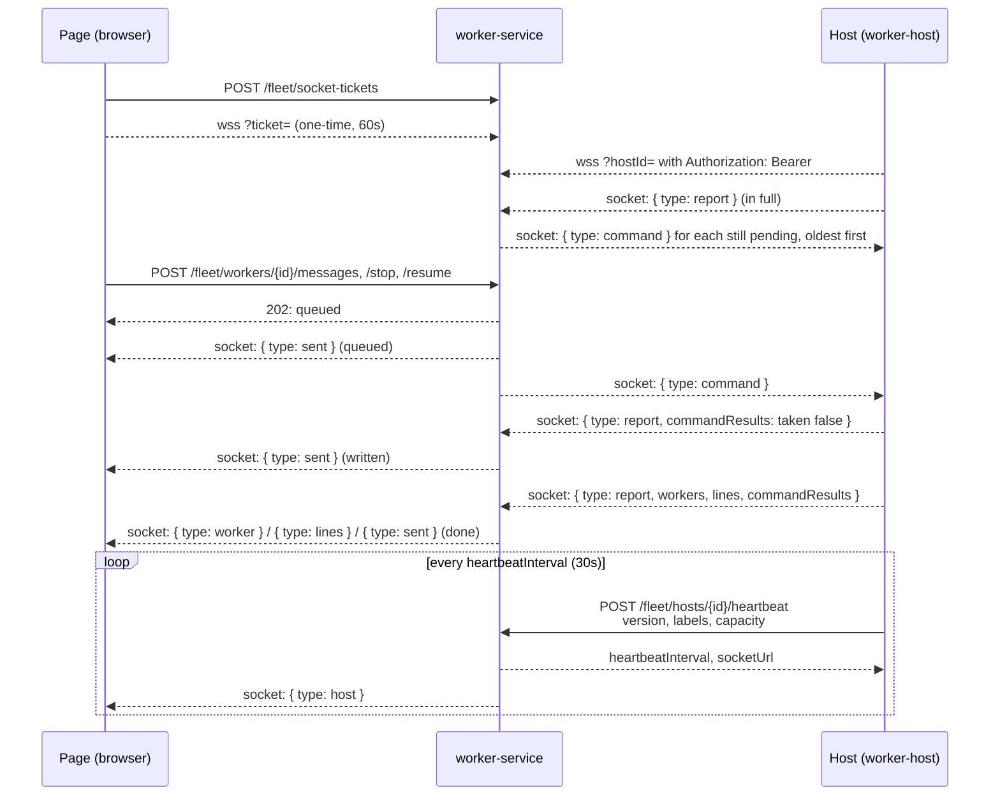

# worker-service

The API for workers: lasting agents, each living on one host, run in sessions.
Hosts run `worker-host`, which keeps each worker's home folder and its tmux
session; this service keeps the record and carries commands and reports between
hosts and the page. A **session** is one run of a worker; one that dies leaves
its worker `interrupted`, and it can be resumed.

The contract is [`openapi.json`](./openapi.json), rendered in
[`docs/API.md`](./docs/API.md). Generate a client rather than writing types:
`npx openapi-typescript openapi.json -o fleet.d.ts`.

## Protocol

Commands and reports go by the host's socket alone; the heartbeat only keeps
the host `connected` and says what it offers. A command waits in its host's
queue until a report names it: it is pushed to the host's socket when written,
and every command still pending is replayed, oldest first, to a host socket
once it opens. A report goes up on the socket when something changes, and in
full on every (re)connect; it is pushed on to watching pages.

The queue is the truth, so a dropped socket loses nothing: what it missed is
replayed to the next. The replay follows the host's first message on the new
socket rather than `$connect` itself, since API Gateway takes no post to a
socket until `$connect` has returned. A command not taken by the time its host
would be `lost` is withdrawn (`create` and `retire` excepted). A host silent over 60s is `disconnected`, over 300s `lost`; a lost
host is sent nothing new, and stopping one of its workers ends the session on record at once, as `force` does.

### The account's usage

Every worker shares one Claude account. A host that sees a `rate_limit_event`
in a session's stream sends its 5-hour and weekly windows as a report's
`usage`: each window's `utilization` (0 to 1) and `resetsAt`, and the event's
time as `readAt`. A window the event leaves out is left out, not sent as 0.
Each window keeps the newest reading by `readAt`, whichever host sent it, and
`GET /fleet/usage` serves both with their `readAt`, so a reader can tell a
stale reading from one whose window has since reset. Every field is null until
a host reports one. Pages are pushed `{ type: usage }` when a newer reading is
kept.

### The tokens a worker used

A host reads the token counts in each session's stream, its subagents'
included, and sends each session's running total as a report's `tokens`:
`inputTokens`, `outputTokens`, `cacheCreationInputTokens` and
`cacheReadInputTokens`, by `workerId` and `sessionId`. Since it is a total and
not an increment, the service keeps the highest of each count per session, so
a total sent again after a reconnect, or one that arrives late, adds nothing.
A worker's `tokens` is the sum over its sessions, kept on a retired worker
too.

## What a worker is given

A worker is made, by a person or a program, with what its job needs:

- **documents**: document-service keys each session reads after `global`, at
  their latest version. An unknown key is refused at creation.
- **credentials**: the services it is given an address and token for, by name
  (`document-service`, `work-tracker`, `worker-service`, `approval-service`;
  without any, all four). Only names are kept. The queued `start` holds the addresses; each
  token is read from Secrets Manager as the `start` is pushed to its host's
  socket, as `secrets`, so no token is stored, listed by `listWorkerCommands`
  or replayed stale, and a rotated secret reaches the next start. The host
  writes them to a file in the worker's folder only it can read, and the
  session's environment is set from that file. A caller may give a name its
  own token (`{name, token}`), in place of the shared one for this worker
  alone: it is kept in Secrets Manager under
  `worker-service/<stage>/workers/<id>/`, never read back, and deleted when
  the worker is retired. A request for a worker in a role (`createRequest`)
  may give such tokens as `tokens` instead, keeping its role's services: each
  must be for one of them.
- **label**, **whenDone**, and **createdBy**, the `claimed-by` header it was
  made with, by which `listWorkers` filters.
- **item**: the work-tracker item it was started on, kept for its life.
  `listWorkers?item=<id>` lists every worker started on it, retired ones
  included, so what they used is still there once they have gone.
- **role**: what kind of worker it is (`GET /fleet/roles`). A role names the
  documents, credentials, `whenDone`, label, brief and priority of the workers
  made from it, so a caller gives `role` and a brief and nothing else; each
  of those it does give overrides the role's, so a caller that names them all,
  as before roles, gets what it names. The stage starts with `planner`,
  `reviewer`, `conflict`, `investigator`, `onboarder` (approval-service's, which
  drafts a repo's routine), `judge` and `implementer` seeded in
  `src/roles.ts`, as their callers made them before; a role written with
  `POST /fleet/roles` or `PATCH /fleet/roles/<name>` is kept in the table and
  replaces its seed. Writing one takes the admin token
  (`worker-service/<stage>/admin-token`), a person's, which does all the stage's
  token does too. The worker keeps its role's name, and `listWorkers?role=`
  filters by it.

## Admission

A caller that does not need its worker now asks for one: `POST
/fleet/requests` with a `role`, a `brief` (or the role's own), and its `item`
or `subject`, and no host or name. The request is `waiting` until it is
admitted: both usage windows under 90% from a reading under 15 minutes old, or
one whose window has since reset, and a connected host carrying its `labels`
with a free slot. Of those waiting, the highest role `priority` starts first,
then the oldest. Admitted, it is made as `createWorker` with its role would
make it, its id the request's and its name `<role>-<first 8 of its id>`, on
the host with the most room, and the request is `started` with its
`workerId`. A request is claimed (on its `rev`) before its worker is made, so
two admissions at once never start it twice; one whose worker could not be
made goes back to waiting, saying why. Each one left waiting says `why`.
`DELETE /fleet/requests/<id>` withdraws a waiting one, and deletes any token
of its own it was given.

Admission runs when a request is made and on every heartbeat. That is the
schedule: nothing can be admitted without a connected host, and every
connected host beats every 30 seconds, carrying its capacity, so room a host
gains, a session ending or a usage reading falling is acted on within 30
seconds.

Each start also carries the **clients** of the services it is given: for each
credential, that service's `GET /skill` (`bin/` and `reference/` of its skill),
read at the address and with the token this stage has for it, and this
service's own (`skill/`: `page` and `title`, served at `GET /fleet/skill`).
They are written over `global`'s files at the same paths, so a worker calls the
API that is deployed where its tokens reach, however far `global` lags. A
`SKILL.md` or `CLAUDE.md` a service sends is dropped: guidance reaches a worker
only through `global`'s votes. Every skill's `bin/` is laid first, then the
documents beside `global`, then each `reference/` while the start has room, so
a client and a role always fit before a reference does. A skill that cannot be
read, or whose `bin/` would take the start past its size limit, is left out and
`global`'s copy stays; a `reference/` that does not fit is left out alone. The
session's `contextNote` says why; the session records each skill it got in
`skills`.

## Whether a worker needs the person

A host can see that a worker's turn ended, its `state` going from `working`
to `waiting`, but not why: a question, finished
work and waiting on its own subagents all end the turn alike. So the worker
says it. Each session is given `WS_URL` and `WS_TOKEN`, and the worker's `page`
skill calls `PUT /fleet/workers/{id}/status` with `working` or `waiting` and a
one-line `summary`, or `done` with its result once it has finished what it was
made for. A worker made with `whenDone: stop` then has its session stopped, and
one made with `retire` is retired; either way it keeps reading `done`, so a
caller can tell a worker that finished from one whose session died. A turn that ends with nothing said since the last one ended
reads `waiting`, so a worker that forgets still reaches the person; a message
to a waiting worker makes it `working`. Only `status: waiting` should notify.
`state` is as its host last reported it, and whether a session is up is read
from it: `working` and `waiting` are live.
