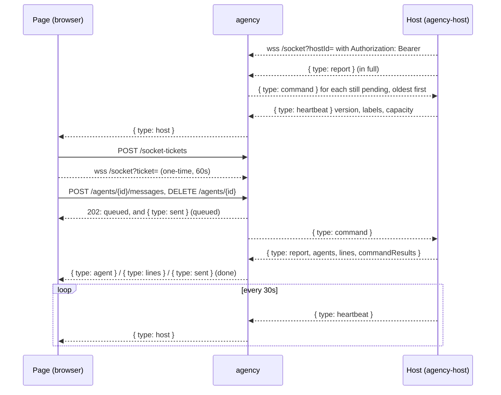

# agency

**Agents at your command, across all your computers.**

```
 █████╗  ██████╗ ███████╗███╗   ██╗ ██████╗██╗   ██╗        ▄▄██▄▄
██╔══██╗██╔════╝ ██╔════╝████╗  ██║██╔════╝╚██╗ ██╔╝    ▄▄██████████▄▄
███████║██║  ███╗█████╗  ██╔██╗ ██║██║      ╚████╔╝    ▀▀▀▀▀▀▀▀▀▀▀▀▀▀▀▀
██╔══██║██║   ██║██╔══╝  ██║╚██╗██║██║       ╚██╔╝      ██  ██  ██  ██
██║  ██║╚██████╔╝███████╗██║ ╚████║╚██████╗   ██║       ██  ██  ██  ██
╚═╝  ╚═╝ ╚═════╝ ╚══════╝╚═╝  ╚═══╝ ╚═════╝   ╚═╝     ▄████████████████▄
v0.2.0

Agents at your command, across all your computers.
Agents, their sessions, the requests that start them and the hosts they run on.

  ▸ Page      http://127.0.0.1:4600/
  ▸ API       http://127.0.0.1:4600/agents   docs http://127.0.0.1:4600/docs/api
  ▸ MCP       http://127.0.0.1:4600/mcp      docs http://127.0.0.1:4600/docs/mcp

  sessions may be given: agency
  listening on http://127.0.0.1:4600, data in ~/.local/share/agency/agency.db
  Ctrl+C to stop.
```

agency was formerly called agent-service, and agency-host, which runs on each host, agent-host.

The API for agents: lasting agents, each living on one host, run in sessions.
Hosts run `agency-host`, which keeps each agent's home folder and its tmux
session; this service keeps the record and carries commands and reports between
hosts and the page. A **session** is one run of an agent; one that dies leaves
its agent `interrupted`, and it can be resumed.

One Node 24 process serves it over HTTP, with its data in one SQLite file,
and a page at `/` that lists agents, requests, hosts, roles and usage, follows
an agent's transcript, and makes, messages and deletes agents,
under the token it asks for. Errors answer `{code, message}`, `code` an
AWS-style exception name such as `ValidationException`.
The contract is [`openapi.json`](./openapi.json), its operations named as
AWS names theirs (`ListAgents`, `CreateRequest`, `PutAgentStatus`), rendered in
[`docs/API.md`](./docs/API.md) in the layout of an AWS API reference and served
at `/docs/api`. An MCP server at `/mcp` (streamable HTTP, stateless, under the
same token) mirrors every operation an agent or person uses as a snake_case
tool (`list_agents`, `create_request`, `put_agent_status`), each one API request
made with the caller's token; its contract is [`mcp.json`](./mcp.json),
rendered in [`docs/MCP.md`](./docs/MCP.md) and served at `/docs/mcp`. `npm run
spec` writes them all, and a test fails if one drifts or a route and the
contract disagree. Generate a client rather than writing types:
`npx openapi-typescript openapi.json -o agents.d.ts`.

## Running it

```sh
npm ci
AUTH_TOKEN=… node src/cli.ts --port 4600 --db ~/.local/share/agency/agency.db \
  --public-url https://<host>.<tailnet>.ts.net:<port> --services services.json
node src/cli.ts backup <file>     # a consistent copy while it serves
```

`AUTH_TOKEN` is what every caller and host presents. `--public-url` is the address agents and
hosts reach it at, given to each session as `AGENCY_URL`; without it, the address
each request came to. `--services` names the other services a session may be
given, with no token in the file:

```json
{
  "waypoint": { "url": "https://…:8444", "urlVar": "WAYPOINT_URL", "tokenVar": "WAYPOINT_TOKEN", "tokenEnv": "WAYPOINT_TOKEN" }
}
```

each token read from this process's variable `tokenEnv`. A service that
serves MCP names its path as `"mcp": "/mcp"`; each session given it is then
handed its server in the start's `mcpServers`, its address and token written
as `${urlVar}` and `${tokenVar}`, which the session's own environment fills,
and agency-host passes them to Claude Code with `--mcp-config`. What ages out (a
command's record, a pending command not durable, an ended request, a spent
ticket) is pruned hourly, `KEPT_FOR` (7 days) after it was queued or ended.

### Its settings

Each option can also be set in the environment, `AGENCY_<NAME>`: `AGENCY_HOST`,
`AGENCY_PORT`, `AGENCY_DB`, `AGENCY_URL` (`--public-url`), `AGENCY_SERVICES` and
`AGENCY_PICK_UP`. The names it had as agent-service, `AGENT_SERVICE_<NAME>`, are
deprecated but still read when the new one is not set, and without `--db` or
`AGENCY_DB` an existing `~/.local/share/agent-service/agent-service.db` is used,
so an install from before the rename keeps working unchanged. Requests and
roles that name the `agent-service` credential are given `agency`'s.

## Hosts

Each machine that runs agents runs
[agency-host](https://github.com/dakotacolorado/agency-host), pointed at this
service's address and `AUTH_TOKEN`; it connects over the protocol below.

## Protocol

A host speaks to agency over one WebSocket at `/socket` on the API's
own address and port (`wss://` behind an HTTPS proxy): it connects with
`?hostId=<id>` and the stage's token as `Authorization: Bearer`, and nothing
else of the API is for it. On every (re)connect it sends its full `report`,
then a `heartbeat` (`version`, `labels`, `capacity`), and a heartbeat every 30
seconds after: only heartbeats keep a host `connected`, and the first from an
id registers it. A report goes up whenever something changes, and is pushed on
to watching pages. The server pings each socket every 30 seconds and closes one
that misses a ping, so a host whose link dropped reconnects.

A command waits in its host's queue until a report names it: it is pushed to
the host's socket when written, and every command still pending is replayed,
oldest first, after the host's first message on a new socket, its full report,
leaving out the commands that report names. A message is delivered to its
agent's live session or not: `done` or `rejected`, with nothing between.



The queue is the truth, so a dropped socket loses nothing: what it missed is
replayed to the next. A command not reported by the time its host would be
`lost` is withdrawn (`create` and `delete` excepted). A host silent over 60s is
`disconnected`, over 300s `lost`; a lost host is sent nothing new.

### The account's usage

Every agent shares one Claude account. A host that sees a `rate_limit_event`
in a session's stream sends its 5-hour and weekly windows as a report's
`usage`: each window's `utilization` (0 to 1) and `resetsAt`, and the event's
time as `readAt`. A window the event leaves out is left out, not sent as 0.
Each window keeps the newest reading by `readAt`, whichever host sent it, and
`GET /usage` serves both with their `readAt`, so a reader can tell a
stale reading from one whose window has since reset. Every field is null until
a host reports one. Pages are pushed `{ type: usage }` when a newer reading is
kept.

### The tokens an agent used

A host reads the token counts in each session's stream, its subagents'
included, and sends each session's running total as a report's `tokens`:
`inputTokens`, `outputTokens`, `cacheCreationInputTokens` and
`cacheReadInputTokens`, by `agentId` and `sessionId`. Since it is a total and
not an increment, the service keeps the highest of each count per session, so
a total sent again after a reconnect, or one that arrives late, adds nothing.
An agent's `tokens` is the sum over its sessions, kept on a deleted agent
too.

## What an agent is given

An agent is made, by a person or a program, with what its job needs:

- **role**: what kind of agent it is (`ListRoles`). Roles live in honed, not
  here: each is a skill `agent-roles/<name>`, its `SKILL.md` what an agent in it
  is told and its `role.json` the settings (`label`, `priority`, `whenDone`,
  `services`, `brief`, `summary`, and any other `skills` it gives). They are
  read from the honed the services file names `honed` at each use, the last
  list read whole kept for when honed does not answer, and changed in honed:
  no operation here writes one. A caller gives `role` and a brief; anything else
  it gives overrides the role's. The agent keeps its role's name, and
  `ListAgents?role=` filters by it.
- **skills**: the honed skills each session is given, by name, at their
  current version: its role's own first. Each is laid whole as a Claude Code
  skill at `skills/<the name's last segment>/`. Each read whole is kept, so when
  honed does not answer a start is given the last good copy and its session's
  `contextNote` says so; one honed says it no longer has is left out, and one
  it does not have is refused at creation. There is no shared context: what an
  agent is told is its role's skill and the skills it names.
- **clients**: every start also carries this service's own `page` and `title`
  skills (`skill/`), as this build has them, so an agent calls the API that is
  deployed.
- **credentials**: the services it is given an address and token for, by name
  (`agency`, which `agent-service`, its former name, also gives, and each the services file names; without any, all of
  them). Only names are kept. The queued `start` holds the addresses; each
  token is read from the service's environment as the `start` is pushed to its
  host's socket, as `secrets`, so no token is stored, listed by `ListCommands`
  or replayed stale, and a rotated secret reaches the next start. The host
  writes them to a file in the agent's folder only it can read, and the
  session's environment is set from that file.
- **label**, **whenDone**, and **createdBy**, the `claimed-by` header it was
  made with, by which `ListAgents` filters.
- **item**: the work item it was started on, kept for its life.
  `ListAgents?item=<id>` lists every agent started on it, deleted ones
  included, so what they used is still there once they have gone.

## Picking up waypoint's tasks

waypoint has no queue, so agency finds work itself when started with
`--pick-up <role>` (or `AGENCY_PICK_UP` in its environment): every 30 seconds it reads the services'
`waypoint` for `ListTasks?ready=true&assignee=none`, oldest first, and for each,
at most 5 a look, asks for an agent in that role (`CreateRequest`, its `item`
the task's id) and sets the task's `assignee` to the agent's name. A task
already asked for is never asked for again; one whose assignee cannot be set is
let go and its request withdrawn; with waypoint down, nothing is taken and the
next look tries again. Admission still decides when each agent starts. Without
the option, no task is taken.

## Admission

A caller that does not need its agent now asks for one: `POST
/requests` with a `role`, a `brief` (or the role's own), and its `item`
or `subject`, and no host or name. The request is `waiting` until it is
admitted: both usage windows under 90% from a reading under 15 minutes old, or
one whose window has since reset, and a connected host carrying its `labels`
with a free slot. Of those waiting, the highest role `priority` starts first,
then the oldest. Admitted, it is made as `CreateAgent` with its role would
make it, its id the request's and its name `<role>-<first 8 of its id>`, on
the host with the most room, and the request is `started` with its
`agentId`. A request is claimed (on its `rev`) before its agent is made, so
two admissions at once never start it twice; one whose agent could not be
made goes back to waiting, saying why. Each one left waiting says `why`.
`DELETE /requests/<id>` withdraws a waiting one.

Admission runs when a request is made and on every heartbeat. That is the
schedule: nothing can be admitted without a connected host, and every
connected host beats every 30 seconds, carrying its capacity, so room a host
gains, a session ending or a usage reading falling is acted on within 30
seconds.

## Whether an agent needs the person

A host can see that an agent's turn ended, its `state` going from `working`
to `waiting`, but not why: a question, finished
work and waiting on its own subagents all end the turn alike. So the agent
says it. Each session is given `AGENCY_URL` and `AGENCY_TOKEN` (and, for now, the
same as `AG_URL` and `AG_TOKEN`, their names before the rename), and the agent's `page`
skill calls `PUT /agents/{id}/status` with `working` or `waiting` and a
one-line `summary`, or `done` with its result once it has finished what it was
made for. An agent made with `whenDone: stop` then has its session stopped, and
one made with `delete` is deleted; either way it keeps reading `done`, so a
caller can tell an agent that finished from one whose session died. A turn that ends with nothing said since the last one ended
reads `waiting`, so an agent that forgets still reaches the person; a message
to a waiting agent makes it `working`. Only `status: waiting` should notify.
`state` is as its host last reported it, and whether a session is up is read
from it: `working` and `waiting` are live.
