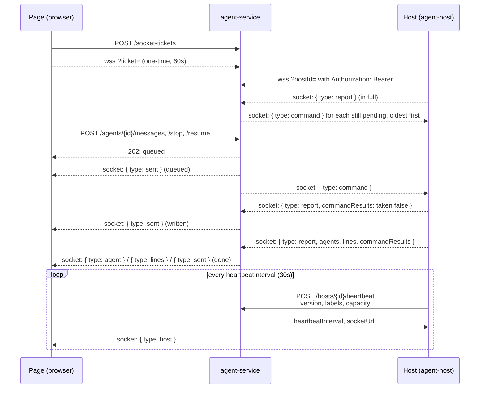

# agent-service

The API for agents: lasting agents, each living on one host, run in sessions.
Hosts run `agent-host`, which keeps each agent's home folder and its tmux
session; this service keeps the record and carries commands and reports between
hosts and the page. A **session** is one run of an agent; one that dies leaves
its agent `interrupted`, and it can be resumed.

One Node 24 process serves it over HTTP, with its data in one SQLite file.
The contract is [`openapi.json`](./openapi.json), its operations named as
AWS names theirs (`ListAgents`, `CreateRequest`, `PutAgentStatus`), rendered in
[`docs/API.md`](./docs/API.md) in the layout of an AWS API reference and served
at `/docs/api`. An MCP server at `/mcp` (streamable HTTP, stateless, under the
same token) mirrors every operation an agent or person uses as a snake_case
tool (`list_agents`, `create_request`, `put_agent_status`), each one API request
made with the caller's token; its contract is [`mcp.json`](./mcp.json),
rendered in [`docs/MCP.md`](./docs/MCP.md) and served at `/docs/mcp`. `npm run
spec` writes them all, and a test fails if one drifts or a route and the
contract disagree. Generate a client rather than writing types:
`npx openapi-typescript openapi.json -o agents.d.ts`.

## Running it

```sh
npm ci
AUTH_TOKEN=… ADMIN_TOKEN=… node src/cli.ts --port 4600 --db ~/.local/share/agent-service/agent-service.db \
  --public-url https://<host>.<tailnet>.ts.net:<port> --services services.json
node src/cli.ts backup <file>     # a consistent copy while it serves
```

`AUTH_TOKEN` is what every caller and host presents; `ADMIN_TOKEN` is a
person's, which also writes roles. `--public-url` is the address agents and
hosts reach it at, given to each session as `AG_URL`; without it, the address
each request came to. `--services` names the other services a session may be
given, with no token in the file:

```json
{
  "waypoint": { "url": "https://…:8444", "urlVar": "WAYPOINT_URL", "tokenVar": "WAYPOINT_TOKEN", "tokenEnv": "WAYPOINT_TOKEN" }
}
```

each token read from this process's variable `tokenEnv`. A service that
serves MCP names its path as `"mcp": "/mcp"`; each session given it is then
handed its server in the start's `mcpServers`, its address and token written
as `${urlVar}` and `${tokenVar}`, which the session's own environment fills,
and agent-host passes them to Claude Code with `--mcp-config`. What ages out (a
command's record, a pending command not durable, an ended request, a spent
ticket) is pruned hourly, `KEPT_FOR` (7 days) after it was queued or ended.

## On a host

`ops/` installs it on a host by hand, as the hosts' other services are:

```sh
ops/deploy beta dakotajp-lenovo-laptop        # from a clean checkout at the commit to release
ops/agent-host ~/agent-host dakotas-hp-laptop 2 linux,x86_64
ops/check                                     # a real session: its context, and a read of waypoint
```

`ops/deploy` builds the checkout, installs it under
`~/.local/share/routines/agent-service/`, keeps `previous` to put back, makes
the host's tokens once in `~/.config/agent-service/env` (its own, and one named
`agent-service` from this host's honed and waypoint), writes the services file
naming them, restarts `agent-service.service` and checks `/health` answers the
commit, serves it at `https://<host>:8446` with `tailscale serve`, and installs
the nightly backup to the other host. `ops/agent-host` installs an agent-host
build beside worker-host and points it at this host's agent-service.

## Protocol

The socket is a WebSocket at `/socket` on the API's own address and port
(`wss://` behind Tailscale HTTPS), which the heartbeat and a socket ticket
give as `socketUrl`. The server pings each socket every 30 seconds and closes
one that misses a ping, so a host whose link dropped reconnects. Commands and reports go by the host's socket alone; the heartbeat only keeps
the host `connected` and says what it offers. A command waits in its host's
queue until a report names it: it is pushed to the host's socket when written,
and every command still pending is replayed, oldest first, to a host socket
once it opens. A report goes up on the socket when something changes, and in
full on every (re)connect; it is pushed on to watching pages.



The queue is the truth, so a dropped socket loses nothing: what it missed is
replayed to the next. The replay follows the host's first message on the new
socket, its full report, so the commands that report names are left out. A command not taken by the time its host
would be `lost` is withdrawn (`create` and `retire` excepted). A host silent over 60s is `disconnected`, over 300s `lost`; a lost
host is sent nothing new, and stopping one of its agents ends the session on record at once, as `force` does.

### The account's usage

Every agent shares one Claude account. A host that sees a `rate_limit_event`
in a session's stream sends its 5-hour and weekly windows as a report's
`usage`: each window's `utilization` (0 to 1) and `resetsAt`, and the event's
time as `readAt`. A window the event leaves out is left out, not sent as 0.
Each window keeps the newest reading by `readAt`, whichever host sent it, and
`GET /usage` serves both with their `readAt`, so a reader can tell a
stale reading from one whose window has since reset. Every field is null until
a host reports one. Pages are pushed `{ type: usage }` when a newer reading is
kept.

### The tokens an agent used

A host reads the token counts in each session's stream, its subagents'
included, and sends each session's running total as a report's `tokens`:
`inputTokens`, `outputTokens`, `cacheCreationInputTokens` and
`cacheReadInputTokens`, by `agentId` and `sessionId`. Since it is a total and
not an increment, the service keeps the highest of each count per session, so
a total sent again after a reconnect, or one that arrives late, adds nothing.
An agent's `tokens` is the sum over its sessions, kept on a retired agent
too.

## What an agent is given

An agent is made, by a person or a program, with what its job needs:

- **documents**: the honed skills each session is given after
  `workplace/global`, by name, at their current version. A name honed does
  not have is refused at creation.
- **credentials**: the services it is given an address and token for, by name
  (`agent-service`, and each the services file names; without any, all of
  them). Only names are kept. The queued `start` holds the addresses; each
  token is read from the service's environment as the `start` is pushed to its host's
  socket, as `secrets`, so no token is stored, listed by `ListCommands`
  or replayed stale, and a rotated secret reaches the next start. The host
  writes them to a file in the agent's folder only it can read, and the
  session's environment is set from that file. A caller may give a name its
  own token (`{name, token}`), in place of the shared one for this agent
  alone: it is kept in a table of its own, never read back, and deleted when
  the agent is retired. A request for an agent in a role (`CreateRequest`)
  may give such tokens as `tokens` instead, keeping its role's services: each
  must be for one of them.
- **label**, **whenDone**, and **createdBy**, the `claimed-by` header it was
  made with, by which `ListAgents` filters.
- **item**: the work-tracker item it was started on, kept for its life.
  `ListAgents?item=<id>` lists every agent started on it, retired ones
  included, so what they used is still there once they have gone.
- **role**: what kind of agent it is (`GET /roles`). A role names the
  documents, credentials, `whenDone`, label, brief and priority of the agents
  made from it, so a caller gives `role` and a brief and nothing else; each
  of those it does give overrides the role's, so a caller that names them all,
  as before roles, gets what it names. The stage starts with `planner`,
  `reviewer`, `conflict`, `investigator`, `onboarder` (approval-service's, which
  drafts a repo's routine), `judge` and `implementer` seeded in
  `src/roles.ts`, as their callers made them before; a role written with
  `POST /roles` or `PATCH /roles/<name>` is kept in the table and
  replaces its seed. Writing one takes the admin token (`ADMIN_TOKEN`), a
  person's, which does all the stage's token does too. The agent keeps its role's name, and `ListAgents?role=`
  filters by it.

## Instructions, from honed

Every session's instructions are honed skills, read when it starts from the
honed the services file names `honed`: `workplace/global`, whose `SKILL.md`
(without its front matter) is the session's `CLAUDE.md`, then each skill the
agent's role names, laid whole as a Claude Code skill at `skills/<the name's
last segment>/`. Each skill read whole is kept in the database, so when honed
does not answer, a start is given the last good copy and its session's
`contextNote` says so; a skill honed says it no longer has is left out. The
session records the version of each in `context` and `documents`.

## Picking up waypoint's tasks

waypoint has no queue, so agent-service finds work itself when started with
`--pick-up <role>` (or `AGENT_SERVICE_PICK_UP`, which a host sets in
`~/.config/agent-service/env`): every 30 seconds it reads the services'
`waypoint` for `ListTasks?ready=true&assignee=none`, oldest first, and for each,
at most 5 a look, asks for an agent in that role (`CreateRequest`, its `item`
the task's id) and sets the task's `assignee` to the agent's name. A task
already asked for is never asked for again; one whose assignee cannot be set is
let go and its request withdrawn; with waypoint down, nothing is taken and the
next look tries again. Admission still decides when each agent starts. Without
the option, no task is taken.

## Admission

A caller that does not need its agent now asks for one: `POST
/requests` with a `role`, a `brief` (or the role's own), and its `item`
or `subject`, and no host or name. The request is `waiting` until it is
admitted: both usage windows under 90% from a reading under 15 minutes old, or
one whose window has since reset, and a connected host carrying its `labels`
with a free slot. Of those waiting, the highest role `priority` starts first,
then the oldest. Admitted, it is made as `CreateAgent` with its role would
make it, its id the request's and its name `<role>-<first 8 of its id>`, on
the host with the most room, and the request is `started` with its
`agentId`. A request is claimed (on its `rev`) before its agent is made, so
two admissions at once never start it twice; one whose agent could not be
made goes back to waiting, saying why. Each one left waiting says `why`.
`DELETE /requests/<id>` withdraws a waiting one, and deletes any token
of its own it was given.

Admission runs when a request is made and on every heartbeat. That is the
schedule: nothing can be admitted without a connected host, and every
connected host beats every 30 seconds, carrying its capacity, so room a host
gains, a session ending or a usage reading falling is acted on within 30
seconds.

Each start also carries the **clients** of the services it is given: for each
credential, that service's `GET /skill` (`bin/` and `reference/` of its skill),
read at the address and with the token this stage has for it, and this
service's own (`skill/`: `page` and `title`, served at `GET /skill`).
They are written over `workplace/global`'s files at the same paths, so an agent
calls the API that is deployed where its tokens reach. A `SKILL.md` or
`CLAUDE.md` another service sends is dropped: guidance reaches an agent through
honed; this service's own `page` and `title` `SKILL.md`s are the exception, as
no honed skill says when to use them. A service with no client answers 404 and
is skipped. Every skill's `bin/` is laid first, then the honed skills beside
`workplace/global`, then each `reference/` while the start has room, so a
client and a role always fit before a reference does. A skill that cannot be
read, or whose `bin/` would take the start past its size limit, is left out
and `workplace/global`'s copy stays; a `reference/` that does not fit is left
out alone. The
session's `contextNote` says why; the session records each skill it got in
`skills`.

## Whether an agent needs the person

A host can see that an agent's turn ended, its `state` going from `working`
to `waiting`, but not why: a question, finished
work and waiting on its own subagents all end the turn alike. So the agent
says it. Each session is given `AG_URL` and `AG_TOKEN`, and the agent's `page`
skill calls `PUT /agents/{id}/status` with `working` or `waiting` and a
one-line `summary`, or `done` with its result once it has finished what it was
made for. An agent made with `whenDone: stop` then has its session stopped, and
one made with `retire` is retired; either way it keeps reading `done`, so a
caller can tell an agent that finished from one whose session died. A turn that ends with nothing said since the last one ended
reads `waiting`, so an agent that forgets still reaches the person; a message
to a waiting agent makes it `working`. Only `status: waiting` should notify.
`state` is as its host last reported it, and whether a session is up is read
from it: `working` and `waiting` are live.
